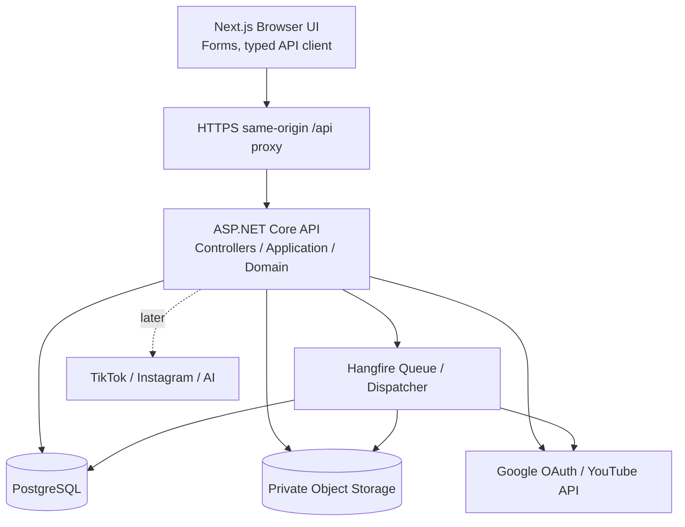
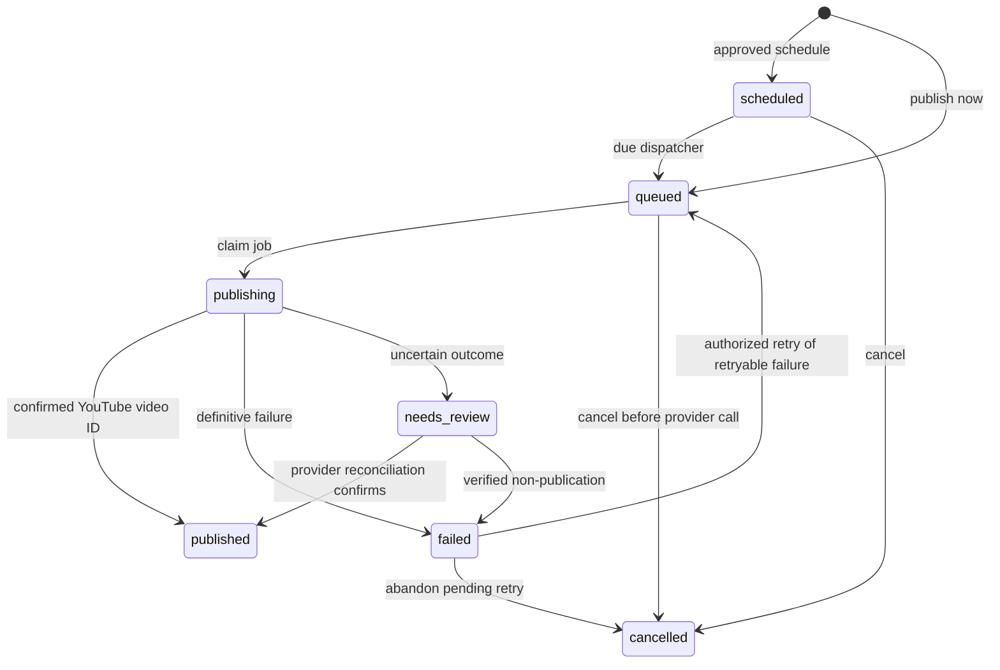

# SocialFlow AI — Backend Architecture

**Task:** #22 (documentation only) · **Baseline:** `main` `a89903237de5`, inspected 2026-11-11  
**Status:** proposed; no backend implemented  
**Companion documents:** [Database](DATABASE_DESIGN.md) · [API](API_CONTRACTS.md) · [Security](SECURITY_DESIGN.md) · [Requirements](PROJECT_REQUIREMENTS.md)

## 1. Scope and decisions

The first end-to-end MVP is **YouTube**: Register/Login → create workspace → upload video → connect YouTube → create post/content → approve → schedule → background publish → track status. This follows `PROJECT_REQUIREMENTS.md` §6. The existing Next.js screens still use mock data.

| ADR | Decision | Why |
|---|---|---|
| A01 | Modular monolith: single ASP.NET Core API and PostgreSQL, with Hangfire | Simple deployment and clear module boundaries; not microservices |
| A02 | Controllers → Application Services → Domain policies → Infrastructure | Business rules never belong in controllers or UI |
| A03 | ASP.NET Core Identity + HttpOnly cookie through same-origin `/api` reverse proxy | No bearer token storage in browser; CSRF protection mandatory |
| A04 | Every tenant record is scoped by `workspace_id`; authorize each read and write | Workspace URL/headers alone cannot grant membership |
| A05 | Post ≠ Publication ≠ PublicationAttempt | One post may succeed on YouTube and fail on another platform |
| A06 | PostgreSQL/EF Core domain tables; Hangfire PostgreSQL storage separately | Atomic domain transactions plus persistent job queue |
| A07 | Media bytes in private object storage, metadata in PostgreSQL | No video blobs in DB by default |
| A08 | All instants stored UTC; workspace timezone defaults to `Europe/Istanbul` | Explicit consistent scheduling/display |
| A09 | HTTP idempotency + DB leases + reconciliation | Prevent duplicate commands; cannot guarantee exactly-once YouTube uploads |
| A10 | `needs_review` for ambiguous external success | Do not blindly retry an uncertain upload |



**Deployment:** one reverse proxy, Next.js runtime, ASP.NET Core API and Hangfire worker (same process in local MVP; a separate **process**, not a new business service, is possible later), PostgreSQL, private object storage. `Hangfire.PostgreSql` is a third-party storage provider; select/pin and integration-test its supported version during implementation.

## 2. Modules and responsibility boundaries

| Module | Owns | Application use cases |
|---|---|---|
| Identity | Identity users + sessions | Register, login, logout, current user, password reset |
| Workspaces | Workspaces, WorkspaceMembers | Create/list/select workspace; owner/admin/member permissions |
| Media | MediaAssets and storage abstraction | Stream, validate, store, inspect media; access control |
| Posts | Posts and PostPlatformContents | Drafts, per-platform content, review/approval, version checks |
| SocialAccounts | SocialAccounts, OAuthStates, TokenCredentials | Connect/disconnect, callbacks, token refresh |
| Publishing | Publications, PublicationAttempts, IdempotencyKeys | Schedule/now/cancel/retry, job dispatch, reconciliation |
| Analytics | AnalyticsDailyRecords | Tenant-scoped reads/aggregation; deferred ingestion |
| Infrastructure | EF Core, Identity adapter, Hangfire, YouTube client, object store, logging | Technical adapters only, no domain rules |

**Per-request path:** controller validates DTO/HTTP → application service loads `ActorContext(userId, authorizedWorkspaceId, role)` → domain enforces invariants → EF Core and external adapters. Workers invoke application services directly, not controllers. The `X-Workspace-Id` header chooses an already-authorized workspace; it is never sufficient proof of access.

**Conceptual future layout (do not create this task):**

```text
backend/
  SocialFlow.Api/              # API controllers, middleware, DI
  SocialFlow.Application/      # use cases, contracts, ports, policies
  SocialFlow.Domain/           # entities, statuses, transition rules
  SocialFlow.Infrastructure/   # EF Core, Identity, OAuth, storage, Hangfire
  SocialFlow.Tests/            # unit/integration/security/worker tests
```

## 3. End-to-end sequence

```mermaid
sequenceDiagram
  autonumber
  participant U as Next.js Browser
  participant API as ASP.NET API
  participant DB as PostgreSQL
  participant S as Private Storage
  participant G as Google/YouTube
  participant W as Hangfire Worker
  U->>API: GET auth/csrf, POST auth/login
  API->>DB: Verify Identity and issue session
  API-->>U: HttpOnly session cookie
  U->>API: POST workspaces (create owner)
  API->>DB: Save workspace + membership
  U->>API: POST media (streamed multipart)
  API->>S: Save private bytes
  API->>DB: Save MediaAsset + readiness
  U->>API: POST social-accounts/youtube/connect
  API->>DB: Persist hashed state / PKCE verifier
  API-->>U: Google authorization URL
  U->>G: Grant YouTube scope
  G->>API: GET OAuth callback (code, state)
  API->>DB: Validate state and store encrypted credentials
  U->>API: POST post; POST post/{id}/schedule
  API->>DB: Verify ownership, ready media, valid account, approval; create Publication
  API-->>U: 202 publication IDs + scheduled status
  W->>DB: Claim due Publication with lease
  W->>S: Read approved media stream
  W->>G: Resume/upload video
  G-->>W: Video ID / error / ambiguous result
  W->>DB: Append Attempt; transition state
  U->>API: GET publications and post details
  API-->>U: Tenant-filtered statuses and attempts
```

**Publishing semantics:** for the first MVP, `scheduledAtUtc` is the earliest time a worker **starts uploading**; completing the upload and YouTube processing may take longer. Exact public visibility at the requested minute is **not promised**. An optional future strategy is upload private ahead of time and use YouTube `status.publishAt`, which has separate eligibility and privacy rules.

## 4. Publishing domain and state machine

Each Publication is tied to one Post, one SocialAccount, and one immutable snapshot of its platform content at approval time. New edits to a post must not silently modify an in-flight upload.



- `published` is confirmed remote acceptance; separate `providerProcessingStatus` can track processing/public visibility. The initial MVP must not equate remote acceptance with fully processed/public video.
- `needs_review` blocks new uploads until reconciled. If YouTube accepted upload and response was lost, a blind second `videos.insert` may duplicate a video.
- Cancellation of a **started** upload is best-effort; never claim that cancellation undid an already-accepted external operation.
- Overall Post status is a **derived read-model**: all publications published → published; mixed published and failed → partial; pending/in-progress aggregate appropriately. Never update stored publications from `posts.status` alone.

### Idempotency, concurrency, recovery

1. Mutating publish commands require `Idempotency-Key` with unique `(workspace_id, actor_user_id, operation, key)` and stored canonical request hash. Repeat same payload → original result; different payload for same key → 409. Retain key/results at least 24h (document exact TTL when implemented).
2. Enforce unique `(workspace_id, post_id, social_account_id)` in Publications. Protect post edits with `version BIGINT` + `If-Match` / `412 Precondition Failed`.
3. A recurring Hangfire dispatcher queries due `scheduled` rows using bounded batches and transactional row locks (`SELECT ... FOR UPDATE SKIP LOCKED`) and claims a `lease_token` + `lease_until_utc`. Queue job args contain only IDs and claim token, **never** tokens or file contents.
4. Hangfire enqueue is not atomic with an EF Core transaction. Reconciliation checks stale queued/publishing claims and re-enqueues safely after lease expiry. Workers must re-check lease ownership and state on every transition. Never hold DB transactions while uploading a video.
5. Persist a resumable YouTube session URL/checkpoint **encrypted** when available, use status query/resume to recover transient faults. If result cannot be determined, set `needs_review`, with operator/user resolution rather than a new upload.
6. Initial transient retry proposal: 3 retries after first attempt with backoff around 1/5/15 minutes plus jitter; honor server `Retry-After`, actual Google quotas and upload guidance. Permanent invalid media, revoked credentials, insufficient scope or validation errors require user intervention.
7. Attempt rows are append-only for outcome evidence: attempt number, lease, start/end, provider request/session reference, normalized code, retryable flag, sanitized message; never include access tokens or entire third-party responses.

**Exactly-once is not guaranteed across a database and the YouTube API.** A combination of client idempotency, DB constraints, fencing/leases and external reconciliation offers bounded, explainable risk, not a proof of exactly-once behavior.

## 5. Media storage and external integrations

Store **video/image bytes in private object storage**, not PostgreSQL by default. PostgreSQL stores object key, content type, bytes, SHA-256, dimensions, duration, processing status, workspace and ownership. For MVP, `POST /api/v1/media` streams multipart requests to a private bucket, with configurable max 1 GiB, request throttles and metadata extraction; large direct multipart object-store uploads are deferred. Do not buffer whole videos in RAM. Use sanitized/synthetic object keys rather than filenames, MIME sniffing, scoped reads, least-privilege credentials, FFmpeg/ffprobe resource isolation and cleanup of incomplete uploads.

**YouTube:** official Google OAuth authorization-code flow, narrowly scoped `https://www.googleapis.com/auth/youtube.upload` when sufficient; request `access_type=offline` for refresh tokens; validate state, exact redirect, PKCE if supported; handle revoked credentials. Use resumable `videos.insert`, explicit user-approved privacy, save confirmed provider video ID. Consult the **current** quota model: YouTube's 2026 documentation describes a separate videos.insert quota bucket (default 100 uploads/day; cost 1 unit in that bucket). November 2026 changed old default-private restrictions for unverified projects. Recheck actual project quota/policies at implementation time.

Sources: [YouTube videos.insert](https://developers.google.com/youtube/data/reference/rest/v3/videos/insert) · [YouTube revision history](https://developers.google.com/youtube/data/revision_history) · [resumable upload](https://developers.google.com/youtube/data/guides/using_resumable_upload_protocol) · [OAuth](https://developers.google.com/identity/protocols/oauth2/web-server) · [Hangfire PostgreSQL package](https://www.nuget.org/packages/Hangfire.PostgreSql/).

## 6. MVP boundary vs later work

| Area | YouTube MVP required | Later, after vertical proof |
|---|---|---|
| Accounts | Secure register/login/logout, owner workspace | Invitations and advanced roles |
| Media | Video stream upload, validation and private storage | Bulk uploads and advanced conversions |
| Connections | Single selected YouTube account, OAuth and refresh | TikTok/Instagram OAuth |
| Posts | Draft + YouTube-specific title/description/tags, approval | Cross-platform content and automatic adaptation |
| Publishing | Due worker, now/schedule, attempts, status, retry/ambiguity | Native YouTube `publishAt` scheduling and other providers |
| Analytics | Publish status/history only; API contract reserved | Platform metrics ingestion / multi-platform analytics |
| AI | No dependency | Transcript-based suggestions, always human-approved |
| Reliability | Tenant security, leases, idempotency, integration tests | Advanced operations/analytics |

## 7. Implementation sequence and verification gates (future tasks)

1. Host skeleton, configuration, Identity and migrations; `ProblemDetails` contract tests.
2. Workspace authorization: prove user A cannot access user B's media, posts, credentials, publications or analytics by changing IDs/headers.
3. Media + Posts: upload streaming/storage safety, per-platform content validation, optimistic concurrency.
4. Google OAuth: one-time state, callback binding, encrypted token storage, revoked/expired token handling.
5. Publishing: transition unit tests, concurrent worker/claim tests, lost enqueue recovery, resumable session recovery, duplicate-delivery simulation.
6. End-to-end YouTube video upload on an authorized test channel; verify provider ID and status; inspect no duplicate after intentional restart.
7. Replace Next.js mock services with typed API clients incrementally; implement UI for `needs_review` and explicit visibility approval.

### Open decisions / explicit risks

- Decide whether **start upload at scheduled time** meets the product's intended meaning. Exact-time visibility would need a separately tested YouTube-native scheduling approach.
- Frontend shows a read-only demo workspace: real workspace selection must use server-authorized IDs, not hidden query strings.
- Existing frontend status unions lack `needs_review`; adapt the UI before live publishing.
- The current README still says “requirements and frontend planning”; update later, not in documentation-only TASK #22.
- Verify real OAuth and quota/account eligibility, privacy visibility and deployment proxy topology before implementation.

**Design approval gate:** review this document together with [DATABASE_DESIGN.md](DATABASE_DESIGN.md), [API_CONTRACTS.md](API_CONTRACTS.md), and [SECURITY_DESIGN.md](SECURITY_DESIGN.md); do not create a backend project during TASK #22.
