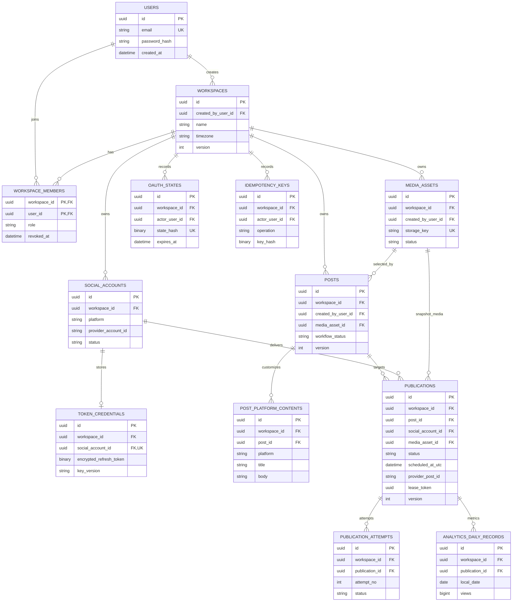

# SocialFlow AI — PostgreSQL / EF Core Database Design

**Task:** #22 (design only) · **Baseline:** `main` `a89903237de5` · **Status:** conceptual schema, no migrations applied.  
**Companions:** [Architecture](BACKEND_ARCHITECTURE.md) · [API](API_CONTRACTS.md) · [Security](SECURITY_DESIGN.md)

## 1. Design conventions

- PostgreSQL 16+ compatible model (actual supported version to be chosen at implementation); `uuid` identifiers for domain entities, `timestamptz` UTC instants, `date` for Istanbul-local analytics buckets, `bigint` for counts and row `version`, `jsonb` for small structured snapshots.
- `Users` denotes **ASP.NET Core Identity `AspNetUsers`**, including Identity password hashes and security stamps. Related Identity tables (`AspNetUserClaims`, `AspNetUserLogins`, `AspNetUserTokens`, optionally `AspNetRoles` etc.) are managed by Identity, **not reimplemented** in this diagram.
- Every tenant-owned table includes non-null `workspace_id` and receives `(workspace_id, id)` unique key when referenced by children; cross-workspace parent references use **composite foreign keys**.
- User identity is global, workspace membership is per workspace. Revoking a member blocks new access, but historical `created_by_user_id` references remain.
- Avoid cascading deletion of publication/attempt/history/credentials. Disable/archive or perform deliberate administrative purge; do not automatically erase an audit chain.
- `posts.workflow_status` (`draft`, `ready`, `approved`, `archived`) is **not** a publication state. A read-model computes overall post display status from Publications. `Publications.status` is authoritative for delivery.
- `TokenCredentials` stores only encrypted token ciphertext / protected references; **never plain tokens**. A KMS/vault reference is an acceptable alternate strategy.

## 2. ER diagram (logical schema)



**Diagram limitation:** Mermaid shows logical links, not the full multi-column tenant FKs, partial indexes or CHECK constraints. Those are specified below. All `workspace_id` relationships are real database constraints, not only code conventions.

## 3. Table definitions — required fields, nullable fields and keys

**Notation:** R = required / `NOT NULL`; O = optional / nullable. `PK` = primary key; `FK` = foreign key; `UK` = unique key. All `created_at`/`updated_at` fields use UTC. UUID generation is performed consistently by application or DB, not by user input.

### 3.1 Users (`AspNetUsers` managed by ASP.NET Core Identity)

| Required | Optional | Constraints / indexes / delete |
|---|---|---|
| `id uuid PK`, `user_name`, `normalized_user_name`, `email`, `normalized_email`, Identity-required security fields | `email_confirmed`, `phone`, profile display name, timestamps according to actual Identity model | Unique normalized username; adopt unique normalized email by policy; standard Identity indices; **Identity handles hashes**, lockout, security stamp. Referenced Users use `ON DELETE RESTRICT` or deliberate anonymization/purge. |

Do not design independent `Users.password` or put a password hash in WorkspaceMembers.

### 3.2 Workspaces

| Required | Optional | Constraints / indexes / delete |
|---|---|---|
| `id uuid PK`, `created_by_user_id uuid FK -> Users`, `name varchar(120)`, `timezone varchar(64) DEFAULT 'Europe/Istanbul'`, `version bigint DEFAULT 1`, `created_at`, `updated_at` | `disabled_at` | `CHECK length(trim(name)) > 0`; `UNIQUE(id)` and optional `(created_by_user_id, created_at)` index; `FK Users RESTRICT`; no cascade of tenant data. |

### 3.3 WorkspaceMembers

| Required | Optional | Constraints / indexes / delete |
|---|---|---|
| `workspace_id uuid`, `user_id uuid`, `role varchar(16)` (`owner/admin/member`), `joined_at` | `revoked_at` | Composite `PK(workspace_id,user_id)`; FKs Workspace/Users **RESTRICT**; index `(user_id,revoked_at)`; `CHECK role IN (...)`. At least one active owner enforced by **transactional application policy**, not simple CHECK. |

### 3.4 SocialAccounts

| Required | Optional | Constraints / indexes / delete |
|---|---|---|
| `id uuid PK`, `workspace_id uuid FK`, `platform varchar(20)`, `provider_account_id varchar(255)`, `display_name varchar(255)`, `status varchar(20)`, `created_at`, `updated_at`, `version bigint DEFAULT 1` | `connected_by_user_id FK Users`, `disconnected_at`, `last_verified_at`, `last_error_code` | `UNIQUE(workspace_id,id)` for tenant FKs; `UNIQUE(workspace_id,platform,provider_account_id)`; index `(workspace_id,status)`; `CHECK platform IN ('youtube','tiktok','instagram')`, status in `connected/expired/error/disconnected`; Workspace/User FKs RESTRICT; **soft disconnect** preserves historical publications. |

The first MVP permits selecting one authorized YouTube account per Publication; database model leaves room for multiple channels later.

### 3.5 TokenCredentials

| Required | Optional | Constraints / indexes / delete |
|---|---|---|
| `id uuid PK`, `workspace_id uuid FK`, `social_account_id uuid FK`, `key_version varchar(80)`, `scopes jsonb`, `updated_at` | `encrypted_refresh_token bytea`, `encrypted_access_token bytea`, `access_expires_at`, `refresh_expires_at`, `secret_reference varchar(512)` | `UNIQUE(workspace_id, social_account_id)`; composite FK `(workspace_id,social_account_id) -> SocialAccounts(workspace_id,id)` **RESTRICT**; CHECK: encrypted material **or** secret reference must be present; credentials inaccessible in normal DTOs; short-lived access token may remain only in protected memory. |

**Never** store OAuth tokens in Hangfire job arguments, normal logs, or frontend data structures.

### 3.6 MediaAssets

| Required | Optional | Constraints / indexes / delete |
|---|---|---|
| `id uuid PK`, `workspace_id uuid FK`, `created_by_user_id FK Users`, `original_filename varchar(255)`, `storage_key varchar(512)`, `media_type` (`video/image`), `mime_type`, `size_bytes bigint`, `status`, `created_at`, `updated_at`, `version bigint DEFAULT 1` | `sha256 bytea`, `duration_ms bigint`, `width int`, `height int`, `processed_at`, `deleted_at`, `failure_code` | `UNIQUE(workspace_id,id)`, `UNIQUE(storage_key)`, index `(workspace_id,status,created_at DESC)`; CHECK `size_bytes >= 0`, positive dimensions/duration; Workspace/Users RESTRICT; referenced media cannot hard delete while publications reference it. |

State: `uploading → processing → ready | failed`. Upload failure can skip processing; use a controlled retry rather than changing state from frontend.

### 3.7 Posts

| Required | Optional | Constraints / indexes / delete |
|---|---|---|
| `id uuid PK`, `workspace_id uuid FK`, `created_by_user_id FK Users`, `title varchar(200)`, `workflow_status varchar(20)` (`draft/ready/approved/archived`), `version bigint DEFAULT 1`, `created_at`, `updated_at` | `media_asset_id uuid`, `description text`, `approved_by_user_id FK Users`, `approved_at`, `deleted_at` | `UNIQUE(workspace_id,id)`; FK `(workspace_id,media_asset_id) -> MediaAssets(workspace_id,id)` RESTRICT; indexes `(workspace_id,created_at DESC,id)`, `(workspace_id,workflow_status,created_at DESC)`; trim title nonblank; workspace/user FKs RESTRICT. |

`approved` signals a user-reviewed snapshot, **not** a successful remote publication. Once a Publication is created its content/media snapshot is frozen. Archiving should not delete live jobs without an explicit cancellation workflow.

### 3.8 PostPlatformContents

| Required | Optional | Constraints / indexes / delete |
|---|---|---|
| `id uuid PK`, `workspace_id uuid FK`, `post_id uuid`, `platform varchar(20)`, `body text`, `tags jsonb DEFAULT '[]'`, `created_at`, `updated_at` | `title varchar(200)`, `call_to_action text`, `extra_json jsonb` | `UNIQUE(workspace_id,id)`; `UNIQUE(workspace_id,post_id,platform)`; composite FK to Posts `(workspace_id,post_id)` RESTRICT; CHECK platform allowed and `tags` JSON array; per-provider title/body constraints in domain validation; `body` may be empty **for a draft** but not on approval where provider requires content. |

### 3.9 Publications — the authoritative delivery state

| Required | Optional | Constraints / indexes / delete |
|---|---|---|
| `id uuid PK`, `workspace_id uuid FK`, `post_id uuid`, `social_account_id uuid`, `media_asset_id uuid`, `status varchar(24)`, `content_snapshot jsonb`, `approved_by_user_id FK Users`, `approved_at`, `attempt_count int DEFAULT 0`, `version bigint DEFAULT 1`, `created_at`, `updated_at` | `scheduled_at_utc timestamptz`, `queued_at`, `published_at`, `provider_post_id varchar(255)`, `provider_processing_status`, `next_retry_at`, `lease_token uuid`, `lease_until_utc`, `last_error_code`, `cancel_requested_at` | `UNIQUE(workspace_id,id)`; `UNIQUE(workspace_id,post_id,social_account_id)`; composite tenant FKs to Posts, SocialAccounts, MediaAssets all **RESTRICT**; `CHECK attempt_count >= 0`; status in `scheduled/queued/publishing/published/failed/cancelled/needs_review`; index `(workspace_id,status,created_at DESC)`; partial index `(status,scheduled_at_utc)` WHERE status='scheduled'; partial index `(status,next_retry_at)` WHERE next_retry_at IS NOT NULL; partial index `(lease_until_utc)` WHERE lease_token IS NOT NULL; unique partial `(social_account_id,provider_post_id)` WHERE provider_post_id IS NOT NULL. |

Required business invariants: `scheduled` requires future `scheduled_at_utc`; `published` requires `provider_post_id` and `published_at`; `publishing` requires a live claim; `content_snapshot` captures approved YouTube fields and selected visibility. Use a constrained JSON schema validated in Application Services. The `social_account_id` must refer to a connected channel of a platform matching the PostPlatformContent used to build the snapshot; this cross-entity business rule is checked transactionally.

### 3.10 PublicationAttempts

| Required | Optional | Constraints / indexes / delete |
|---|---|---|
| `id uuid PK`, `workspace_id uuid FK`, `publication_id uuid`, `attempt_no int`, `status varchar(24)` (`started/succeeded/failed/uncertain`), `started_at timestamptz` | `ended_at`, `retryable boolean`, `error_code varchar(100)`, `sanitized_error text`, `provider_request_id`, `provider_post_id`, `encrypted_upload_session bytea`, `uploaded_bytes bigint`, `worker_lease_token uuid` | Composite FK to Publications `(workspace_id,publication_id)` RESTRICT; `UNIQUE(workspace_id,publication_id,attempt_no)`; index `(workspace_id,publication_id,started_at DESC)`; CHECK attempt_no>=1, uploaded_bytes>=0. Append attempts; only completion/checkpoint fields may update during in-flight execution. |

### 3.11 AnalyticsDailyRecords (post-MVP ingestion)

| Required | Optional | Constraints / indexes / delete |
|---|---|---|
| `id uuid PK`, `workspace_id uuid FK`, `publication_id uuid`, `local_date date`, `views bigint DEFAULT 0`, `likes bigint DEFAULT 0`, `comments bigint DEFAULT 0`, `source varchar(40)`, `fetched_at` | `shares bigint NULL`, `raw_provider_ref` (non-secret), `engagements_cached bigint` (optional) | Composite FK to Publications `(workspace_id,publication_id)` RESTRICT; `UNIQUE(workspace_id,publication_id,local_date)`; index `(workspace_id,local_date,publication_id)`; CHECK all counts >=0, shares NULL means **unavailable**, not zero. Application service only ingests confirmed successful Publications. |

`local_date` is the **workspace-local day** (`Europe/Istanbul` default). Source counts are defined as **daily increments** for a given calendar day; if YouTube provides cumulative counters, ingestion must compute normalized increments or revise the contract explicitly before real integration. Existing frontend Mock Analytics must be reviewed for snapshot-versus-increment semantics before replacing fixtures. No analytics record may be fabricated from failed/scheduled publications.

### 3.12 OAuthStates — short-lived, one-time authorization attempts

| Required | Optional | Constraints / indexes / delete |
|---|---|---|
| `id uuid PK`, `workspace_id uuid FK`, `actor_user_id uuid FK Users`, `provider varchar(20)`, `state_hash bytea`, `session_binding_hash bytea`, `redirect_path varchar(256)`, `expires_at`, `created_at` | `encrypted_pkce_verifier bytea`, `consumed_at`, `nonce_hash bytea` | `UNIQUE(state_hash)`; index `(expires_at)` for TTL cleanup; index `(workspace_id,actor_user_id,created_at DESC)`; `redirect_path` must be an allowlisted local path; bind the attempt to an initiating session; verifier is required if PKCE is used; Workspace/User RESTRICT; consume state atomically only once. |

### 3.13 IdempotencyKeys

| Required | Optional | Constraints / indexes / delete |
|---|---|---|
| `id uuid PK`, `workspace_id uuid FK`, `actor_user_id uuid FK Users`, `operation varchar(100)`, `key_hash bytea`, `request_hash bytea`, `state` (`in_progress/completed`), `created_at`, `expires_at` | `http_status int`, `response_json jsonb`, `completed_at` | `UNIQUE(workspace_id,actor_user_id,operation,key_hash)`; index `(expires_at)` for retention cleanup; FK Workspace/User RESTRICT; identical key/different request hash → 409; 24h minimum retention initially. |

## 4. Cross-workspace safety at database level

The following are **representative constraint specifications**, not a migration or executable deployment script:

```sql
-- Composite tenant identity on parent:
UNIQUE (workspace_id, id) -- on Posts, MediaAssets, SocialAccounts, Publications

-- Child cannot reference a parent from a different workspace:
FOREIGN KEY (workspace_id, post_id)
  REFERENCES posts (workspace_id, id) ON DELETE RESTRICT;
FOREIGN KEY (workspace_id, social_account_id)
  REFERENCES social_accounts (workspace_id, id) ON DELETE RESTRICT;
FOREIGN KEY (workspace_id, media_asset_id)
  REFERENCES media_assets (workspace_id, id) ON DELETE RESTRICT;

-- Prevent duplicate platform publication for a single account:
UNIQUE (workspace_id, post_id, social_account_id)
```

Application authorization must additionally query `WHERE workspace_id = @resolvedWorkspaceId` and check active `WorkspaceMembers(user_id, workspace_id)` and role **before** every access; a foreign key does not authenticate the caller. Defense-in-depth PostgreSQL RLS may be evaluated later, but no claim is made that RLS is enabled in the MVP.

**Tenant-escape tests:** create users A/B in workspaces W1/W2, enumerate `GET/PATCH/DELETE` by known foreign media/post/publication IDs, send wrong `X-Workspace-Id`, manipulate body IDs and try cross-workspace FKs; expect `403` for selecting an unauthorized workspace and `404` for missing/foreign resources within an authorized workspace. Worker queries must also always carry `workspace_id`.

## 5. Delete behavior and retention

| Relationship | Delete policy | Rationale |
|---|---|---|
| Workspace → child rows | `RESTRICT`, workspace may be disabled; explicit purge service later | No accidental deletion of publication/credentials history |
| Users → Workspaces/Members/Posts | `RESTRICT` until controlled account delete/anonymization workflow | Preserve authorship and audit semantics |
| Posts → Contents/Publications | `RESTRICT` after publications exist; draft may be soft-deleted | Prevent dangling history |
| SocialAccount → TokenCredentials/Publications | Soft disconnect, retain account record; secret revocation/erasure via explicit credential cleanup | Never cascade delete publication history |
| MediaAsset → Posts/Publications | `RESTRICT` while referenced, soft-delete or retention cleanup when eligible | Published history must remain attributable |
| Publication → Attempts/Analytics | `RESTRICT` (no cascade) | Preserve outcome evidence |
| OAuthStates/IdempotencyKeys | TTL job deletes expired records, after verifying no active transaction | Bound storage and replay window |

Sensitive OAuth secret ciphertext may be shredded on disconnect while retaining non-sensitive account metadata. Document data retention and user-data deletion rules before production release.

## 6. Concurrency and EF Core mapping notes

- Use explicit `version BIGINT` as an EF Core optimistic concurrency token; increments occur within the same database transaction. Request `If-Match: "rev-<n>"` for edits; stale revisions → `412`.
- Scheduler uses row-locking with `SKIP LOCKED`, bounded leases, and updates guarded by `lease_token`. PostgreSQL writes plus Hangfire enqueue are **not** one distributed transaction; reconciliation repairs missed enqueues.
- On OAuth callback consume `(state_hash, consumed_at IS NULL, expires_at > now)` in a transaction; unique key and consumed transition prevent replay.
- Authoritative API timestamps: RFC 3339 UTC (e.g. `2026-11-12T17:00:00Z`), never date-only strings for an instant. Analytics `date` fields are local `YYYY-MM-DD`.
- Unique constraints live in the database in addition to DTO validation, with SQLSTATE unique violations mapped safely to `409` / `ProblemDetails`.
- Add future migration tests checking FK cascade behavior, uniqueness, reverse migrations and ability to seed two completely isolated workspaces.

## 7. Feasibility/acceptance scenarios

1. A user creates a workspace and becomes `owner`; another user has no membership and cannot read its posts.
2. The same media cannot be referenced by a post in a different workspace even with forged IDs.
3. A Post has one YouTube Publication in MVP and multiple Attempts after transient failures; no duplicate Publication on repeated schedule command.
4. One future multi-platform Post may contain published YouTube and failed Instagram Publications; display `partial`, preserving both.
5. Failed or queued publication ID never contributes to AnalyticsDailyRecords; missing shares remain NULL.
6. Concurrent dispatcher invocations result in a single active fenced lease; crashed worker's lease can expire without blindly repeating an uncertain remote upload.
7. Revoke account credentials without deleting old Publications and audit attempts.

**No SQL migrations, `DbContext`, or live DB were created during TASK #22.**
